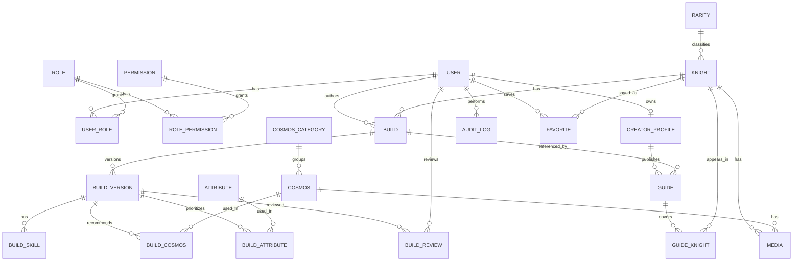

# SSA-KOTZ — Modelo de dados

> Status: **planejado**. Este documento descreve o modelo-alvo; não significa que as tabelas já existem.

## Regras para agentes de IA

1. Leia este documento antes de criar ou alterar models, migrations, seeds e consultas Prisma.
2. Não implemente todo o modelo por iniciativa própria: execute somente o módulo pedido na tarefa.
3. O `schema.prisma` e as migrations são a fonte da verdade sobre **o que está implementado**; este documento é a referência do **que se pretende implementar**. Se houver divergência, sinalize-a antes de fazer mudanças estruturais.
4. Não renomeie tabelas, relações ou campos de outros módulos sem justificar o impacto e solicitar autorização.
5. Nunca use `prisma db push`, `migrate reset` ou comandos destrutivos em bancos com dados sem autorização explícita. Prefira migrations versionadas.
6. Use chaves estrangeiras, índices, unicidade e ações de exclusão explícitas. Não confie apenas em validação no frontend.
7. Para tabelas associativas, use chaves compostas onde adequado. Não duplique cosmos, cavaleiros ou atributos por build.
8. Preserve o histórico aprovado: edições de conteúdo publicado geram uma versão nova, não sobrescrevem a versão pública.
9. Antes de concluir uma alteração de banco, informe o que mudou, os comandos executados e eventuais migrações pendentes.

## Convenções

- Banco: PostgreSQL; ORM: Prisma.
- Nomes dos models em inglês e PascalCase; campos em camelCase.
- UUIDs nas entidades principais; `Int` autoincremental para cadastros auxiliares, quando conveniente.
- Campos `createdAt` e `updatedAt` nas entidades editáveis.
- URLs de imagens e metadados no banco; arquivos fora do banco.
- `slug` único para páginas públicas de cavaleiros e guias.
- As regras de autorização e transição de estados são aplicadas no backend.

## Entidades planejadas

| Domínio | Models | Papel |
|---|---|---|
| Identidade | `User`, `Role`, `Permission`, `UserRole`, `RolePermission` | Autenticação e RBAC |
| Criadores | `CreatorProfile` | Perfil do canal e aprovação |
| Catálogo | `Rarity`, `Knight`, `CosmosCategory`, `Cosmos`, `Attribute`, `Media` | Dados compartilhados do jogo |
| Builds | `Build`, `BuildVersion`, `BuildSkill`, `BuildCosmos`, `BuildAttribute` | Builds oficiais e comunitárias, com versões |
| Conteúdo | `Guide`, `GuideKnight` | Guias e vídeos relacionados a cavaleiros |
| Controle | `BuildReview`, `AuditLog`, `Favorite` | Moderação, auditoria e favoritos |

## Relacionamentos

## Campos centrais

- `User`: `id`, `name`, `email` (único), `passwordHash`, `active`.
- `Role`: `id`, `name` (único). `Permission`: `id`, `key` (único). Relações N:N por `UserRole` e `RolePermission`.
- `CreatorProfile`: `id`, `userId` (único), `displayName`, `youtubeChannelUrl`, `status` (`PENDING`, `APPROVED`, `REJECTED`).
- `Rarity`: `id`, `name` (único). `Knight`: `id`, `rarityId`, `name`, `variant?`, `slug` (único), `active`.
- `CosmosCategory`: `id`, `name` (único). Categorias iniciais: vermelho, amarelo, azul e lendário.
- `Cosmos`: `id`, `categoryId`, `name`, `slug` (único). `Attribute`: `id`, `name` (único).
- `Build`: `id`, `knightId`, `authorId`, `title`, `type` (`OFFICIAL`/`COMMUNITY`), `publishedVersionId?`.
- `BuildVersion`: `id`, `buildId`, `versionNumber`, `status` (`DRAFT`, `PENDING`, `PUBLISHED`, `REJECTED`, `ARCHIVED`), `description?`, timestamps. `@@unique([buildId, versionNumber])`.
- `BuildSkill`: `id`, `buildVersionId`, `type` (`MINIMUM`, `IDEAL`, `MAXIMIZED`), `levels` (string, como `1433`), `cost?`; uma linha de cada tipo por versão.
- `BuildCosmos`: `buildVersionId`, `cosmosId`, `displayOrder`; chave composta. `BuildAttribute`: `buildVersionId`, `attributeId`, `displayOrder`; chave composta.
- `Guide`: `id`, `creatorId`, `buildId?`, `title`, `slug`, `youtubeVideoId?`, `status`. `GuideKnight`: chave composta `(guideId, knightId)`.
- `Media`: `id`, `knightId?`, `cosmosId?`, `url`, `type`, `altText?`, `isPrimary`; exatamente um de `knightId` ou `cosmosId` deve estar preenchido.
- `BuildReview`: `id`, `buildVersionId`, `reviewerId`, `decision`, `reason?`, `createdAt`.
- `AuditLog`: `id`, `userId`, `action`, `entity`, `entityId`, `details?`, `createdAt`.
- `Favorite`: chave composta `(userId, knightId)`.

## Restrições e pontos de atenção

- **Apenas uma build `OFFICIAL` por cavaleiro**: implementar com índice único parcial no PostgreSQL para `(knightId)` onde `type = 'OFFICIAL'` (migration SQL); não criar `@@unique([knightId, type])`, pois isso bloquearia múltiplas builds comunitárias.
- `Build.publishedVersionId` precisa pertencer à mesma `Build`. Evite referência circular obrigatória na criação; use vínculo opcional e valide a associação na camada de serviço ou com constraint apropriada.
- A versão publicada permanece imutável. Para editar, crie `BuildVersion` com número seguinte e estado `DRAFT`.
- `BuildCosmos` e `BuildAttribute` referenciam **BuildVersion**, não `Build`, para que versões tenham recomendações próprias.
- `displayOrder` reflete a ordem de apresentação, não necessariamente uma classificação de força.
- `BuildSkill.levels` deve preservar o texto da sequência e validar o formato quando a regra do jogo estiver definida.
- Decisões de moderação devem registrar o revisor e a justificativa quando houver rejeição.
- Conteúdo de `Guide` também precisa de uma política de moderação; se guias publicados forem editáveis por criadores, adotar versionamento ou submissões de alteração antes de liberar a funcionalidade.
- A exclusão de registros referenciados deve ser controlada; preferir desativação/arquivamento para entidades públicas.

## Origem dos dados

A planilha de upskills e cosmos será importada **em etapa futura**, nunca no bootstrap inicial. Normalizar cavaleiros, raridades, cosmos, categorias e atributos antes de relacioná-los; preservar as URLs de guias e documentar dados ambíguos. A importação deverá ser idempotente.

## Escopo atual

Na primeira etapa, apenas inicializar aplicações, banco, Prisma e documentação. **Não criar models, migrations de domínio, CRUDs, autenticação ou importação até uma tarefa explícita solicitar.**
